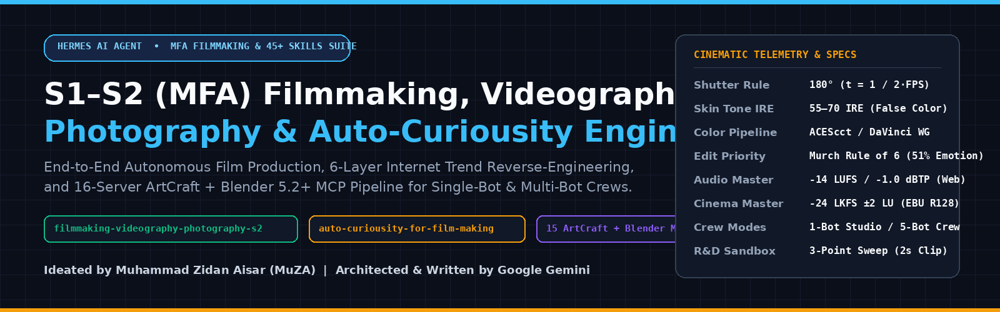
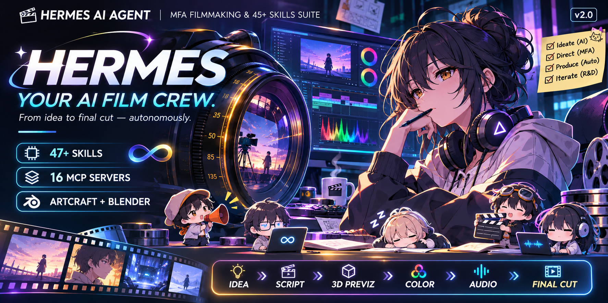
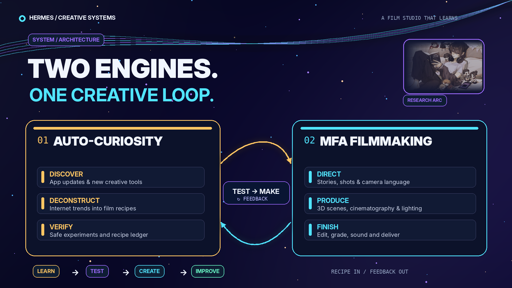
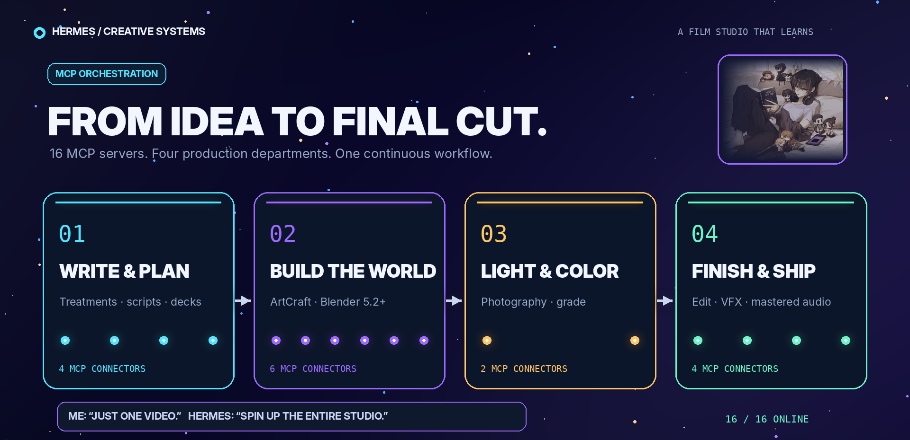

# Hermes & Universal S1–S2 (BFA/MFA) Filmmaking Advisor, Eternal-Student Auto-Curiosity & 48 AI Agent Skills Suite



[](./CHANGELOG.md)
[](https://github.com/NousResearch/hermes-agent)
[](#2-kompatibilitas-lintas-semua-ai-agent-hermes-1-openclaw-chatgpt-claude--lainnya)
[](https://github.com/HKUDS/CLI-Anything)
[](./skills)
[](https://gemini.google.com)
[-F59E0B?style=flat-square)](https://github.com/zidanaisar624)
[](./LICENSE)

> **Summary (English)**: *Suite of 48 Collaborative AI Agent Skills featuring an internet-researched S1–S2 (BFA/MFA) Filmmaking, Cinematography & Photography Advisor (built as a humble Co-Pilot with deep respect for film students & human film crews—NEVER a replacement) + Eternal-Student Auto-Curiosity R&D & Trend Forecasting Engine. Native CLI-Anything zero-MCP ready (with optional 15 ArtCraft apps & Blender 5.2+ integration) for Hermes, OpenClaw, ChatGPT & Claude. Born from a fun experiment, architected by Google Gemini, and 100% free to use.*

Repositori ini berisi ekosistem **48 Modular & Interoperable AI Agent Skills** (`SKILL.md` + modul referensi teknis + *CLI-Anything Agent Harness*) yang dirancang utama (**Prioritas #1**) untuk **Hermes Agent**, sekaligus **100% kompatibel dengan OpenClaw, ChatGPT (Custom GPTs, Projects & Codex CLI), Claude (Claude Code, Desktop & Claude Projects), Cursor, dan seluruh agen berstandar `agentskills.io`**, serta mendukung eksekusi hemat token via **`CLI-Anything`** maupun integrasi **15 aplikasi ArtCraft & Blender 5.2+**.

> [!IMPORTANT]
> ### Penghormatan untuk Anak Kuliah Film & Pekerja Sinema: *Advisor* Riset, BUKAN Pengganti Manusia!
> Skill utama di repositori ini disusun semata-mata dari **mencari tahu, menelusuri, dan merangkum informasi publik/silabus terbuka di internet mengenai apa yang dipelajari pada jenjang S1 (BFA/Sarjana) dan S2 (MFA/Magister) Perfilman, Sinematografi (Videografi), serta Fotografi**.
>
> Kami menaruh **rasa hormat setinggi-tingginya kepada mahasiswa kuliah film, lulusan sekolah sinema, serta seluruh kru film di lapangan**. Kumpulan catatan internet di dalam AI **tidak akan pernah sebanding dan tidak pernah diklaim setara** dengan jam terbang syuting nyata di lapangan (*on-set*), kepekaan rasa, latihan empati, diskusi ruang *editing*, maupun tempaan fisik dan mental anak kuliah film. Karena itu, **sistem ini BUKAN pengganti orang film**, melainkan hadir dengan rendah hati sebagai **Advisor / Teman Diskusi Riset & Co-Pilot Teknis**—untuk membantu mengecek hitungan optik/audio, mempelajari *update* aplikasi baru, membedah serta memprediksi tren visual, dan mengotomasi *command-line* repetitif. Jiwa karya dan keputusan kreatif tetap **100% milik manusia**.

> **Asal-Usul Proyek (Attribution)**: Berawal dari eksperimen seru (*fun experiment*) dan rasa penasaran **Muhammad Zidan Aisar (MuZA)** untuk merancang penasihat riset videografi/fotografi lintas-agen yang terus belajar mandiri layaknya mahasiswa abadi (*Eternal Student*), diarsiteki dan ditulis bersama **Google Gemini**, serta **100% gratis untuk digunakan siapa saja**.

---

## 🎬 Creative & Technical Film Advisor — Powered by Eternal Curiosity



*Research-backed S1–S2 filmmaking & photography advisory — zero MCP bloat, universal across agents, always learning.*

---

## Daftar Isi

1. [Kompatibilitas Native `CLI-Anything` (Tanpa Boros Token MCP!)](#1-kompatibilitas-native-cli-anything-tanpa-boros-token-mcp)
2. [Kompatibilitas Lintas Semua AI Agent (Hermes #1, OpenClaw, ChatGPT, Claude & Lainnya)](#2-kompatibilitas-lintas-semua-ai-agent-hermes-1-openclaw-chatgpt-claude--lainnya)
3. [Instalasi Otomatis Pintar (Auto-Scan Disk & Memori untuk Semua User)](#3-instalasi-otomatis-pintar-auto-scan-disk--memori-untuk-semua-user)
4. [Automasi Cek & Update Langsung dari Terminal (`hmfa check` / `hmfa update`)](#4-automasi-cek--update-langsung-dari-terminal-hmfa-check--hmfa-update)
5. [Trio Skill Inti: Advisor S1–S2 + Eternal-Student Auto-Curiosity + CLI Bridge](#5-trio-skill-inti-advisor-s1s2--eternal-student-auto-curiosity--cli-bridge)
6. [Spesifikasi Kurikulum Riset `filmmaking-videography-photography-s2`](#6-spesifikasi-kurikulum-riset-filmmaking-videography-photography-s2)
7. [Eternal Student & Prediksi Tren di `auto-curiousity-for-film-making`](#7-eternal-student--prediksi-tren-di-auto-curiousity-for-film-making)
8. [Jaringan Kolaborasi Penuh Antar Semua 48+ Skills](#8-jaringan-kolaborasi-penuh-antar-semua-48-skills)
9. [Mode Dewan Penasihat: Single-Agent (8 Lensa) vs Multi-Bot Crew](#9-mode-dewan-penasihat-single-agent-8-lensa-vs-multi-bot-crew)

---

## 1. Kompatibilitas Native `CLI-Anything` (Tanpa Boros Token MCP!)

Menyambungkan belasan server MCP sekaligus menyuntikkan ratusan skema JSON ke *system prompt* di setiap giliran percakapan (**menghabiskan 15.000–40.000+ token bahkan sebelum Anda mengetik pesan**).

Repositori ini kini **kompatibel penuh dengan [HKUDS/CLI-Anything](https://github.com/HKUDS/CLI-Anything)**:
- **0 Token Idle Context**: Agen memanggil *harness* CLI berformat `--json` (`cli-anything-blender`, `cli-anything-kdenlive`, `cli-anything-shotcut`, `cli-anything-gimp`, `cli-anything-krita`, `cli-anything-inkscape`, `cli-anything-audacity`, `cli-anything-obs-studio`, `cli-anything-videocaptioner`, `cli-anything-comfyui`, `cli-anything-libreoffice`) dan CLI native (`ffmpeg`, `ffprobe`, `darktable-cli`, `exiftool`, atau `*-cli.exe` lokal) **hanya saat dibutuhkan lewat terminal**.
- **Paket `agent-harness/` Bawaan (`cli-anything-filmmaking` / `hmfa`)**: Repositori ini menyertakan *namespace package* resmi `cli_anything.filmmaking_advisor` yang mendukung mode satu-perintah (`--json`) maupun mode interaktif **Stateful REPL**:
  ```bash
  hmfa --json preflight
  hmfa --json optics --focal-mm 35 --f-stop 2.0 --fps 24 --platform youtube
  hmfa --json curiosity onboard-app --app blender
  ```
- **MCP Bersifat Opsional**: Jika pengguna memang sudah menyalakan server MCP (seperti Blender MCP atau ArtCraft MCP), *skill* tetap dapat memakainya sebagai jalur sekunder—namun **tidak pernah diwajibkan**.

---

## 2. Kompatibilitas Lintas Semua AI Agent (Hermes #1, OpenClaw, ChatGPT, Claude & Lainnya)

| Platform / Ekosistem Agen | Status Dukungan | Cara Kerja & Integrasi di Repositori Ini |
| :--- | :--- | :--- |
| **1. Hermes Agent** *(Prioritas Utama #1)* | **Native Auto-Discovery (Root + Semua Bot Profiles)** | Otomatis menemukan lokasi data Hermes di disk mana pun (`~/.hermes`, `%LOCALAPPDATA%\hermes`, `D:\HermesData`, partisi kustom, WSL) + seluruh profil Bot Mode (`profiles/*`) tanpa pernah menyentuh `provider` atau `model` di `config.yaml`! Juga mendukung `hermes skills tap add`. |
| **2. OpenClaw** | **Native `SKILL.md` (`~/.openclaw/skills`)** | Mematuhi standar YAML frontmatter `OpenClaw` & `agentskills.io` tanpa ketergantungan *tool* eksklusif platform lain. |
| **3. ChatGPT** *(Custom GPTs, Projects & Codex)* | **Siap Upload + Auto-Install Codex** | Tersedia paket siap pakai di [`exports/chatgpt/`](./exports/chatgpt/) ([`01_PASTE_INTO_CHATGPT_INSTRUCTIONS.md`](./exports/chatgpt/01_PASTE_INTO_CHATGPT_INSTRUCTIONS.md) & [`02_UPLOAD_AS_CHATGPT_KNOWLEDGE_BASE.md`](./exports/chatgpt/02_UPLOAD_AS_CHATGPT_KNOWLEDGE_BASE.md)), serta auto-install ke `~/.codex/skills` untuk pengguna OpenAI Codex CLI. |
| **4. Claude** *(Claude Code, Desktop & Web Projects)* | **Plugin Marketplace + `~/.claude/skills` + Projects** | Otomatis terpasang ke `~/.claude/skills`, mendukung `/plugin marketplace add zidanaisar624/hermes-mfa-filmmaking-and-agent-skills` ([`.claude-plugin/`](./.claude-plugin/marketplace.json)), dan panduan Claude Projects di [`adapters/claude/CLAUDE_PROJECT_GUIDE.md`](./adapters/claude/CLAUDE_PROJECT_GUIDE.md). |
| **5. Agen Universal Lainnya** *(Cursor, Antigravity, Gemini CLI, Windsurf, Cline)* | **Native `AGENTS.md` + `~/.agents/skills`** | Menyertakan [`AGENTS.md`](./AGENTS.md), [`.cursor-plugin/`](./.cursor-plugin/marketplace.json), dan sinkronisasi otomatis ke direktori standar `~/.agents/skills`. |

---

## 3. Instalasi Otomatis Pintar (Auto-Scan Disk & Memori untuk Semua User)

Tidak ada lagi *path* yang terkunci untuk satu komputer tertentu! Installer pintar kami otomatis menyesuaikan diri dengan kompleksitas partisi disk (`C:`, `D:`, `E:`, SSD eksternal, WSL, Linux, macOS) dan kapasitas penyimpanan pengguna (otomatis memakai *NTFS Junction / Symlink* hemat ruang disk dengan *fallback* salin aman):

### Opsi A — One-Liner Langsung dari Terminal (Tanpa Perlu Clone Manual)

**Windows (PowerShell):**
```powershell
irm https://raw.githubusercontent.com/zidanaisar624/hermes-mfa-filmmaking-and-agent-skills/main/install.ps1 | iex
```

**Linux / macOS / WSL / Git Bash:**
```bash
curl -fsSL https://raw.githubusercontent.com/zidanaisar624/hermes-mfa-filmmaking-and-agent-skills/main/install.sh | sh
```

### Opsi B — Clone & Jalankan Installer Universal (PowerShell / CMD / Python)

```powershell
git clone https://github.com/zidanaisar624/hermes-mfa-filmmaking-and-agent-skills.git
cd hermes-mfa-filmmaking-and-agent-skills

# Di CMD atau klik dua kali:
install.bat

# Atau di PowerShell:
.\install.ps1

# Opsi tambahan (misal hanya cek target disk tanpa menulis file, atau khusus Hermes saja):
python install.py --dry-run
python install.py --hermes-only
```

### Opsi C — Via `hermes skills` / `npx skills` CLI
```bash
hermes skills tap add zidanaisar624/hermes-mfa-filmmaking-and-agent-skills
npx skills add zidanaisar624/hermes-mfa-filmmaking-and-agent-skills
```

---

## 4. Automasi Cek & Update Langsung dari Terminal (`hmfa check` / `hmfa update`)

Setelah instalasi pertama selesai, perintah global **`hmfa`** (alias **`hermes-filmmaking`** dan **`cli-anything-filmmaking`**) otomatis terdaftar di terminal **PowerShell**, **CMD**, maupun **Bash**. Anda **tidak perlu lagi membuka browser ke GitHub atau `cd` ke folder repo** untuk mengecek maupun menarik pembaruan:

```powershell
# 1. Cek apakah ada update terbaru di GitHub (dari folder mana saja di CMD / PowerShell!)
hmfa check

# 2. Tarik update terbaru otomatis & sinkronkan ulang ke Hermes + semua Agent!
hmfa update

# 3. Cek kesehatan instalasi Hermes lintas drive, profil bot, dan aplikasi kreatif
hmfa status

# 4. (Opsional) Aktifkan pengingat update otomatis ringan tiap 24 jam saat membuka PowerShell
hmfa auto-check enable
```

> **Jaminan Keamanan Update**: `hmfa update` mendukung pembaruan via `git pull --ff-only` maupun unduhan arsip HTTPS otomatis (bahkan bagi pengguna tanpa Git), **tidak pernah menyentuh `provider`/`model` di `config.yaml`**, dan menjaga seluruh catatan belajar di `curiosity_ledger/` tetap aman!

---

## 5. Trio Skill Inti: Advisor S1–S2 + Eternal-Student Auto-Curiosity + CLI Bridge



| Skill Inti | Direktori | Peran Utama | Output & Artefak |
| :--- | :--- | :--- | :--- |
| **`filmmaking-videography-photography-s2`** | [`skills/filmmaking-videography-photography-s2/`](./skills/filmmaking-videography-photography-s2/SKILL.md) | **Creative & Technical Advisor** berbasis riset kurikulum S1–S2 perfilman, videografi (`16:9` & `9:16`), dan fotografi. Membantu kreator manusia di 5 fase produksi. | Naskah Fountain/AV, *Shot List*, Kalkulasi Optik/IRE/LUFS, Panduan Grading & Editing |
| **`auto-curiousity-for-film-making`** | [`skills/auto-curiousity-for-film-making/`](./skills/auto-curiousity-for-film-making/SKILL.md) | **Eternal Student Engine** yang otomatis mempelajari setiap *update* aplikasi, mempelajari **setiap aplikasi baru yang disambungkan**, menyerap ilmu baru, membedah tren, hingga **memprediksi tren masa depan**. | `connected_apps_registry.json`, `tested_recipes_registry.json`, `trend_forecasts.json` |
| **`cli-anything-filmmaking-bridge`** | [`skills/cli-anything-filmmaking-bridge/`](./skills/cli-anything-filmmaking-bridge/SKILL.md) | **Zero-MCP Token Execution Bridge** yang menghubungkan rekomendasi kreatif ke `HKUDS/CLI-Anything` (`cli-hub`, `cli-anything-* --json`) & CLI kreatif lokal. | Eksekusi deterministik `--json` tanpa beban token skema MCP |

---

## 6. Spesifikasi Kurikulum Riset `filmmaking-videography-photography-s2`

Skill [`filmmaking-videography-photography-s2`](./skills/filmmaking-videography-photography-s2/SKILL.md) merangkum hasil riset terbuka dari literatur sekolah film S1–S2 (*USC, AFI, NYU Tisch, buku teks optik, penyuntingan, dan tata suara*) menjadi panduan penasihat terukur:

- **Penyutradaraan & Skenario**: Struktur 3-Babak, *Story Circle*, *Save the Cat*, struktur 4-Babak Asia Timur **Kishōtenketsu**, serta *YouTube Retention Architecture* dalam format **Fountain** dan **Two-Column AV Script**, lengkap dengan *blocking* *I/A/L-Formation*, **180-Degree Axis**, dan **30-Degree Rule**.
- **Fisika Sinematografi & Fotografi**:
  - **180-Degree Shutter Rule**: $t = \frac{1}{2 \times \text{FPS}}$ (`24 fps -> 1/48s` atau `1/50s` PAL; rekomendasi filter ND di luar ruang).
  - **Hyperfocal Distance**: $H = \frac{f^2}{N \cdot c} + f$ serta psikologi panjang fokus (`14mm` s/d `200mm`).
  - **Inverse Square Law ($I \propto 1/d^2$) & False Color IRE**: Rasio *Key-to-Fill* (`2:1` *Book Light*, `4:1` *Rembrandt*, `8:1+` *Chiaroscuro*) dan penempatan eksposur kulit pada `55–70 IRE` (guard `< 95 IRE`).
- **Penyuntingan, Color Science & Psychoacoustic Audio**:
  - **Walter Murch's Rule of Six**: Emosi (`51%`) > Cerita (`23%`) > Ritme (`10%`) > *Eye-Trace* (`7%`) > Bidang 2D (`5%`) > Ruang 3D (`4%`).
  - **4-Stage Color Grading** (*ACEScct / DaVinci Wide Gamut -> Skin-Tone Vectorscope I-Line -> Halation/Grain -> Rec.709 / sRGB*).
  - **Standar Loudness**: **`-14.0 LUFS` (`-1.0 dBTP`)** untuk YouTube/Shorts/Web dan **`-24.0 LKFS` (`-2.0 dBTP`)** untuk Cinema/Broadcast.

---

## 7. Eternal Student & Prediksi Tren di `auto-curiousity-for-film-making`

Skill [`auto-curiousity-for-film-making`](./skills/auto-curiousity-for-film-making/SKILL.md) membentuk AI menjadi **pembelajar abadi (*Eternal Student*)** melalui 5 kapabilitas berkesinambungan:

1. **Belajar Setiap Aplikasi Baru yang Disambungkan (*Dynamic New-App Onboarding*)**:
   - Setiap kali pengguna menambahkan atau menyambungkan aplikasi baru (lewat `cli-hub`, CLI native, Python/Lua API, atau sumber lain), agen menjalankan `hmfa curiosity onboard-app`, memeriksa *harness* `CLI-Anything`, mempelajari dokumentasinya, dan melakukan kalibrasi aman di `curiosity_ledger/sandbox_tests/<nama-app>/`.
2. **Belajar Setiap Update Fitur Aplikasi (*Continuous Update Diffing*)**:
   - Membandingkan versi, `--help`, *changelog*, dan daftar filter/node terhadap `app_capabilities_snapshot.json`, lalu mengujinya dengan **3-Point Parameter Sweep** (*Low 20%, Default, Extreme 95%*) tanpa menyentuh file proyek utama pengguna.
3. **Belajar Ilmu Baru Terkait (*Domain Knowledge Evolution*)**:
   - Proaktif meneliti perkembangan sains warna baru (mis. ACES 2.0, AgX, HDR), optik komputasional, dan riset psikologi perhatian penonton di internet dengan verifikasi kutipan.
4. **Bedah Tren 6-Lapisan & Prediksi Tren Masa Depan (*5-Signal Trend Forecasting*)**:
   - Selain membedah tren saat ini ke 6 lapisan kuantitatif, agen **memprediksi tren visual & editing 1–12 bulan ke depan** menggunakan **5 Sinyal Prediktif** (*1. Kurva Kejenuhan Audiens & Efek Bandul/Counter-Trend; 2. Jeda Demokratisasi Fitur Software 3–9 Bulan; 3. Perubahan Spesifikasi/Algoritma Platform; 4. Gelombang Difusi Lintas-Medium Festival -> Mainstream; 5. Skor Kecepatan Adopsi & Kebaruan*) yang dicatat beserta skor keyakinan & kriteria falsifikasi di `curiosity_ledger/trend_forecasts.json`.
5. **Suplai Kartu Resep & Advisory ke Produksi**:
   - Mengirimkan *Cinematic Recipe Cards* dan rekomendasi *early-mover* secara mulus ke `filmmaking-videography-photography-s2`.

---

## 8. Jaringan Kolaborasi Penuh Antar Semua 48+ Skills

Seluruh **48 *skills*** di direktori [`skills/`](./skills/) (ditambah *skill* eksternal apa pun yang dipasang pengguna di agennya) dirancang untuk saling berkolaborasi mendukung **Auto-Curiosity** dan **Filmmaking Advisor** (lihat [`cross-skill-synergy-mesh.md`](./skills/auto-curiousity-for-film-making/references/cross-skill-synergy-mesh.md)):

| Klaster Kolaborasi | Daftar Skill (`skills/<nama-skill>/`) |
| :--- | :--- |
| **Core Filmmaking Advisor, Curiosity & CLI-Anything (3)** | `filmmaking-videography-photography-s2`, `auto-curiousity-for-film-making`, `cli-anything-filmmaking-bridge` |
| **AI Research, Sandbox R&D & Code Introspection (14)** | `autoresearch`, `ai-research-explore`, `ai-research-reproduction`, `analyze-project`, `explore-code`, `explore-run`, `paper-context-resolver`, `brainstorming-research-ideas`, `creative-thinking-for-research`, `idea-generation`, `novelty-assessment`, `deep-research`, `literature-review`, `github-research` |
| **Academic Writing, Pitching & Traceability (8)** | `research-paper-writing`, `paper-writing-section`, `paper-revision`, `rebuttal-writing`, `academic-plotting`, `table-generation`, `slide-generation`, `backward-traceability` |
| **Mathematics, Data Science & Trend Modeling (4)** | `math-reasoning`, `data-analysis`, `symbolic-equation`, `notebooklm-thinking-datascience` |
| **LLM Benchmarking & Token/Workflow Observability (5)** | `evaluating-code-models`, `evaluating-llms-harness`, `nemo-evaluator-sdk`, `langsmith-observability`, `phoenix-observability` |
| **Web Intelligence & Horizon Scanning Suite (5)** | `firecrawl-deep-research`, `firecrawl-research-papers`, `firecrawl-competitive-intel`, `firecrawl-dashboard-reporting`, `firecrawl-knowledge-base` |
| **Human-Centric Pacing, Multi-Persona & Portability (9)** | `focus-my-energy`, `generate-fresh-ideas`, `get-more-perspectives`, `match-my-writing-style`, `prep-for-meetings`, `prep-for-meetings-2`, `parenting-6d-gad-mdd`, `persona-shizuka-yukino-shikaku`, `chatgpt-hermes-portability-kit` |

---

## 9. Mode Dewan Penasihat: Single-Agent (8 Lensa) vs Multi-Bot Crew



Diatur di dalam [`references/single-vs-multibot-crew-roles.md`](./skills/filmmaking-videography-photography-s2/references/single-vs-multibot-crew-roles.md):
- **Mode A — Single-Agent "8-Department Advisory Lens"**: Satu agen (di Hermes, OpenClaw, ChatGPT, atau Claude) meninjau proyek Anda secara berurutan dari 8 sudut pandang departemen sekolah film (*Producer, Screenwriter, Director, DP/Photographer, Art Director, Editor, Colorist/VFX, Sound Designer*).
- **Mode B — Multi-Bot Studio Advisory Crew**: Membagi peran penasihat & asisten teknis ke beberapa profil spesialis paralel (mis. profil *Director*, *Visual/DP*, *Technical/CLI*, *Story/Research*, dan *Producer/Pacing*) tanpa pernah mengambil alih kemudi artistik dari kreator manusia.

---

## Lisensi & Kredit

Dirilis secara terbuka dan gratis di bawah lisensi [MIT License](./LICENSE).
- **Inisiator Konsep & Eksperimen Sistem**: **Muhammad Zidan Aisar (MuZA)**
- **Riset Kurikulum, Arsitektur CLI-Anything & Rekayasa Multi-Agen**: **Google Gemini**
